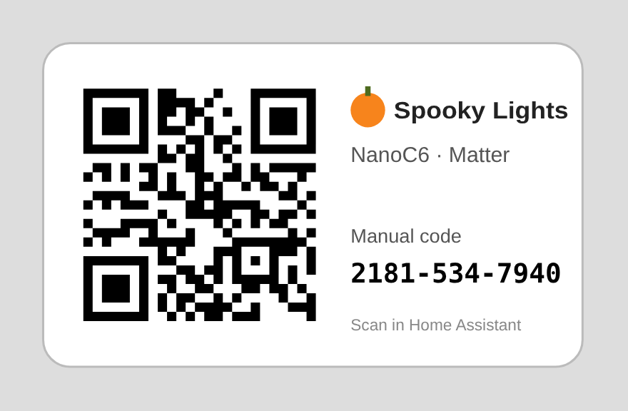

# 🎃 Spooky Lights — a Zigbee / Matter Halloween light for Home Assistant

An **M5Stack M5NanoC6** (ESP32-C6) or **M5NanoH2** (ESP32-H2) becomes a colour
light with ten Halloween effects and a **Demo Reel** for filming. It drives the
board's own RGB LED and/or a string of **Grove Chainable RGB LED v2.0** modules,
**counts the modules live as you plug them in or pull them out**, and re-flows
every effect to fit.

Pick your radio when you flash it:
* **Zigbee:** a Zigbee router for ZHA or Zigbee2MQTT.
* **Matter over Thread:** pair it by **scanning a QR code**. Works with Home
  Assistant, Apple Home, Google Home and SmartThings.

A companion **Home Assistant integration (HACS)** turns either into a proper
light, with a named effect list, a spotlight slider whose range tracks the string
length, a "LED added/removed" event, and a jump-scare button.

[](https://hacs.xyz/)
[](https://github.com/rightiswrong/m5nanoc6-zigbee-lighting-control/actions/workflows/validate.yml)
[](https://github.com/rightiswrong/m5nanoc6-zigbee-lighting-control/releases/latest)

---

## What's in the box

| Path | What |
|---|---|
| `firmware/SpookyLights/` | One Arduino sketch for both boards and both radio stacks |
| `custom_components/spooky_lights/` | Home Assistant integration (installed by HACS) |
| `tools/matter_label.py` | Printable Matter pairing labels (QR + manual code) from the serial output |
| `zigbee2mqtt/nanoc6_spooky.mjs` | Optional external converter if you use Zigbee2MQTT instead of ZHA |
| `docs/MATTER.md` | Matter over Thread: what you need, QR pairing, labels, troubleshooting |
| `docs/WIRING.md` | Wiring, including the loopback needed for hot-plug detection |
| `docs/PUBLISHING.md` | How to get the integration into the HACS default list |
| `tools/hosttest/` | Firmware compiled on a PC against a bit-level P9813 chain simulator and Zigbee / Matter stand-ins |
| `tests/` | Integration logic tests + firmware ⇄ integration sync checks |
| `.github/workflows/` | Validation on every push; `release.yml` builds all four firmware images and publishes a release whenever the version in `manifest.json` is bumped |

## The effects

| # | Effect | What it does |
|---|---|---|
| 0 | Solid | Your chosen colour, steady |
| 1 | Candle Flicker | Every pixel is its own flame; dims redden like embers, the odd gust nearly snuffs one out |
| 2 | Ghost Breath | A slow breath rolls down the string, peaks bleaching toward moonlit white |
| 3 | Lightning Storm | Brooding blue sky; strikes of 1–4 stutters that spill to neighbouring pixels |
| 4 | Witch's Cauldron | Churning emerald ⇄ violet brew with bubbles that swell and pop |
| 5 | Tell-Tale Heart | *lub-dub* … rippling outward from the middle of the string |
| 6 | Haunted Chase | One glowing eye with a comet tail prowls, sometimes doubling back; on a single LED it watches… and blinks |
| 7 | Poltergeist | Mostly dark; pixels get thrown into lurid colours, and now and then the whole string stutters |
| 8 | Possessed Pumpkin | A friendly orange candle — until it turns sickly green and jitters for a moment |
| 9 | Blood Moon | A slow tide of crimson, rust and near-black |
| 10 | **Demo Reel** | A scripted tour of everything, made for filming (below) |

Effects 0–3 and 5–7 take their base colour from the light's colour picker.
Brightness, speed (1–100), and on/off fades apply to all of them.

### 🎬 Demo Reel

Select **Demo Reel** (or click the button until you reach it) and the light
performs a self-running show, about **82 seconds per loop** at speed 50:

| Scene | Shows off |
|---|---|
| 1 Roll call | Pixels answer one by one in rainbow colours, then a white "count off": every module is addressable and was detected |
| 2 Colour wheel | A rainbow rolling down the string: the full RGB range |
| 3 – 11 | Every effect in turn, each **cued to do its signature move on camera**: the candle gust, two lightning strikes, the cauldron boiling over, the chase doubling back, the poltergeist grabbing the power, the pumpkin's possession |
| 12 Finale | Three strobes, fade to black, and round again |

Made for retakes:
* **Every loop is identical.** Each scene starts from a fixed random seed, so take
  two has the same strikes at the same moments as take one.
* **Scenes crossfade** over 1.2 s.
* **The serial log announces each scene** (`[demo] 5/12 Lightning Storm`) for
  lining up captions.
* **The speed control stretches or squeezes the whole reel.** Speed 25 is about
  2.3 minutes per loop; speed 100 is about 21 s.
* **Plug a module in mid-demo** and it wakes up and joins the show, which also
  shows off hot-plug detection.

---

## Quick start

### 1. Wire it
Plug Grove Chainable LEDs into the board's Grove port and daisy-chain them.
For **automatic module counting**, add the two-resistor sense tap and the
return wire described in [`docs/WIRING.md`](docs/WIRING.md). Without it,
everything still works: set the count by hand from Home Assistant, and set
`CHAIN_DETECT_LOOPBACK 0` in `config.h`.

### 2. Flash the firmware

**Option A: prebuilt binary (fastest).** Every [release](https://github.com/rightiswrong/m5nanoc6-zigbee-lighting-control/releases/latest)
has four images:

| Board | Zigbee (ZHA / Z2M) | Matter over Thread (QR code) |
|---|---|---|
| M5NanoC6 | `spooky-nanoc6-zigbee-<ver>-factory.bin` | `spooky-nanoc6-matter-<ver>-factory.bin` |
| M5NanoH2 | `spooky-nanoh2-zigbee-<ver>-factory.bin` | `spooky-nanoh2-matter-<ver>-factory.bin` |

Open [ESPHome Web](https://web.esphome.io) in Chrome or Edge, connect the board
by USB-C, choose **Install** and pick the file. Or from a terminal:

```bash
esptool --chip esp32c6 write_flash 0x0 spooky-nanoc6-zigbee-v1.1.1-factory.bin   # esp32h2 for the NanoH2
```

A `-factory.bin` rewrites the whole flash, **including the Zigbee network /
Matter pairing**. That's right for a first install and for switching between
Zigbee and Matter. For updates, flash the matching `-app.bin` at `0x10000`; it
keeps the pairing.

The prebuilt images use the default `config.h` (loopback detection on, 24-module
maximum, 1000 mA budget). To change those, build it yourself:

**Option B: Arduino IDE.**
1. Arduino IDE 2.x → Boards Manager → **esp32 by Espressif Systems ≥ 3.3.12**.
2. Open `firmware/SpookyLights/SpookyLights.ino`.
3. Tools menu:

   | | Zigbee | Matter over Thread |
   |---|---|---|
   | Board | **ESP32C6 Dev Module** (NanoC6) / **ESP32H2 Dev Module** (NanoH2) | same |
   | USB CDC On Boot | **Enabled** | **Enabled** |
   | Partition Scheme | **Zigbee ZCZR 4MB with spiffs** | **Huge APP (3MB No OTA/1MB SPIFFS)** |
   | Zigbee mode | **Zigbee ZCZR (coordinator/router)** | **Disabled** |
   | Erase All Flash Before Sketch Upload | — | **Enabled** the first time |

4. Upload. Open the Serial Monitor at 115200 to watch it count modules.

The **Zigbee mode** menu is the only switch: the same sketch becomes a Zigbee
router or a Matter light. As a Zigbee device it's a **router** because the
board is USB-powered, so it strengthens your mesh for battery sensors out on the
porch instead of just using it.

### 3a. Pair over Zigbee (ZHA)
Settings → Devices & services → Zigbee Home Automation → **Add device**, then
power the board. The blue LED blinks while it searches and goes dark once
joined. It appears as **SpookyLab NanoC6-Spooky** (or **NanoH2-Spooky**) with a
light, a "Grove LEDs detected" sensor and five number controls.
Already paired somewhere else? Hold the button **5 s** until the LED turns red,
then release to factory-reset Zigbee.

*Zigbee2MQTT user?* Copy `zigbee2mqtt/nanoc6_spooky.mjs` into
`<z2m data>/external_converters/` and restart Z2M before pairing.

### 3b. Pair over Matter (QR code)
You need a **Thread border router**, the HA **Matter** integration, and the HA
Companion app (details in [`docs/MATTER.md`](docs/MATTER.md)). The light prints
its **own** pairing QR code on the serial monitor at boot, and every minute
until it's paired:

```
  ==== NanoC6 Spooky Lights — ready to pair (Matter) ====
      █████████████████████████████
      ██ ▄▄▄▄▄ █  ▀▀█▀▄███ ▄▄▄▄▄ ██
      …
  Manual pairing code : 2181-534-7940
```

In the Companion app: **Settings → Devices & services → Add device → Add Matter
device**, then scan it straight off the screen. Or make a sticker to keep on the
device:

```bash
python3 tools/matter_label.py --log serial.txt --name "Porch pumpkin"   # → spooky-label.svg
```



### 4. Install the integration with HACS
Until it's in the HACS default list: HACS → ⋮ → **Custom repositories** →
`https://github.com/rightiswrong/m5nanoc6-zigbee-lighting-control`, type **Integration** → Download → restart Home Assistant.

[](https://my.home-assistant.io/redirect/hacs_repository/?owner=rightiswrong&repository=m5nanoc6-zigbee-lighting-control&category=integration)

Then Settings → Devices & services → **Add integration → Spooky Lights** and
pick the light:
* **Matter lights** are mapped automatically; just confirm.
* **Zigbee lights** show the auto-mapped entities for you to check.

---

## What you get in Home Assistant

| Entity | From | Purpose |
|---|---|---|
| **Haunted light** | integration | On/off, brightness, colour **and a named effect list** — works in light cards, scenes, `light.turn_on` with `effect:` |
| **Effect** (select) | integration | Pick an effect by name |
| **Output** (select) | integration | Auto · Onboard only · Grove only · Onboard + Grove |
| **Effect speed** (number) | integration | 1–100, 50 = normal (also stretches the Demo Reel) |
| **Spotlight pixel** (number) | integration | One pixel holds the light colour while the rest keep haunting. **Its maximum follows the live pixel count**; if the string shrinks below the chosen pixel, the spotlight switches off |
| **Active pixels** (sensor) | integration | How many pixels the effect is painting, with detected/manual/output attributes |
| **Chain change** (event) | integration | Fires `led_added` / `led_removed` with `previous`, `current`, `pixels` |
| **Jump scare** (button) | integration | 8 s of full-brightness Lightning Storm, then restores everything |
| Grove LEDs detected, Manual LED count, … | ZHA / Z2M | The raw Zigbee firmware controls |
| Effect / speed / spotlight / setup dimmers, lux sensor | Matter | The raw Matter endpoints. Spooky Lights hides them from the device page, since it shows them better (see [MATTER.md](docs/MATTER.md#what-the-light-exposes-over-matter)) |

A bus event `spooky_lights_chain_changed` is fired too, for automations that
prefer event triggers.

### Example automations

```yaml
# Doorbell → jump scare
- alias: Trick-or-treat scare
  triggers:
    - trigger: state
      entity_id: binary_sensor.front_doorbell
      to: "on"
  actions:
    - action: button.press
      target:
        entity_id: button.nanoc6_spooky_jump_scare

# Tell me when a module is unplugged (kids, cables, wind…)
- alias: Spooky string lost a light
  triggers:
    - trigger: state
      entity_id: event.nanoc6_spooky_chain_change
      attribute: event_type
      to: led_removed
  actions:
    - action: notify.mobile_app_phone
      data:
        message: >
          A Grove LED went dark: {{ trigger.to_state.attributes.previous }} →
          {{ trigger.to_state.attributes.current }} modules.

# Dusk: candles. 22:00: something else moves in.
- alias: Halloween evening
  triggers:
    - trigger: sun
      event: sunset
  actions:
    - action: light.turn_on
      target: { entity_id: light.nanoc6_spooky_haunted_light }
      data: { effect: Candle Flicker, rgb_color: [255, 90, 0], brightness: 200 }
    - delay: "03:00:00"
    - action: light.turn_on
      target: { entity_id: light.nanoc6_spooky_haunted_light }
      data: { effect: Possessed Pumpkin }
```

(Entity IDs depend on your device name — check Settings → Entities.)

---

## How it works (the reasoning, step by step)

**1 · Zigbee shape.** The Arduino-ESP32 Zigbee library gives us standard ZCL
endpoints. A *Color Dimmable Light* (endpoint 10) handles on/off, level and
colour. Everything Halloween-specific rides on generic **Analog Input/Output**
endpoints (11–15). Because those are standard clusters, ZHA creates entities
for them with no custom quirk, naming each from the `description` attribute the
firmware sets. The integration then maps those raw entities to meaningful
controls. Zigbee endpoints are fixed at pairing time, so rather than adding or
removing endpoints when the string changes, **the count is data** — reported
live on endpoint 11 — and every control that depends on it adapts.

**2 · One sketch, two radio stacks.** The Arduino *Zigbee mode* menu decides
which transport is compiled in: `TransportZigbee.cpp` or `TransportMatter.cpp`.
Both follow one rule. Radio callbacks (Zigbee or Matter task) only copy values
into a shared `ShowState` under a spinlock. `loop()` renders at 50 fps and then
publishes whatever differs from what the controller last heard. So a button
press, a restored setting and a controller command all reach Home Assistant the
same way, and nothing re-enters the radio stack from its own task. That matters
because Matter's `attribute::update()` can echo back into the callbacks, so
those are written to be idempotent. Settings are saved to NVS 5 s after the last
change to spare the flash.

**2½ · Matter.** The ESP32-H2's Matter library allows only seven endpoints,
root included. Matter also has no "number" device. So the firmware packs
everything into six endpoints every controller understands:
* a colour light;
* dimmers whose level carries the effect, speed, spotlight pixel and "setup"
  (output mode and manual LED count), in bands that survive Home Assistant's
  level ↔ brightness conversion;
* a light sensor reporting the LED count as count + 1 lux. Lux is the one unit
  HA never converts to imperial.

The host test's Matter stand-in enforces the same per-chip endpoint limits, so a
design that doesn't fit fails the build instead of a board.

Each light draws a random setup passcode and discriminator on first boot (never
the shared 20202021 test code), keeps them in flash, and prints its onboarding
QR code with Unicode half blocks. The vendored Nayuki encoder draws it.

**3 · Driving the P9813.** Each module takes a 32-bit word: flag bits `11`, an
inverted checksum of the colour's top bits, then B, G, R — framed by 32 zero
bits. It's bit-banged on G1 (clock) and G2 (data) at ~150 kHz; a 24-module
frame takes ~5 ms. The end frame is padded to 64 bits so modules that re-time
the stream by one clock still latch.

**4 · Counting modules on a write-only bus.** A P9813 chain never answers, so
counting requires the last module's output to return to the controller (see
[WIRING](docs/WIRING.md)). Every 1.5 s the normal refresh becomes a *probe*:
after each clock edge the firmware briefly releases G2 (with the clock held low,
so module #1 ignores it), reads the returning line through the divider, and
drives the next bit. Each module delays the stream by one 32-bit word, so the
first `1` (a flag bit) arrives at bit `32 + 32·N + d` → **N = (i − 32) / 32**.
The probe sends real colours, so it never blinks. A new count must be seen on
two consecutive probes (contact bounce while plugging) before it's accepted.

**4½ · Which way round is the Grove port?** M5Unified (the library M5 uses
on these boards) puts clock on G1 and data on G2 on both boards, but the NanoH2
docs page lists them the other way round. With a loopback fitted, a boot scan
that finds nothing tries the pair swapped and remembers whichever orientation
answers, so either is fine.

**5 · Effects on a virtual canvas.** Effects draw into *n* virtual pixels,
where *n* comes from the output mode (onboard, chain, or onboard + chain). When
*n* changes, new pixels are "summoned" with a 1.5 s pale shimmer instead of
popping on. Then: spotlight → brightness × fade (perceptual) → gamma 2.2 →
**power limiter** (estimated mA per channel, uniform scale-down to the budget)
→ WS2812 via RMT + P9813 chain. The **Demo Reel** runs two effect engines
side by side so scenes can crossfade. It re-seeds each scene's random generator
for repeatable takes, and calls each effect's `cue()` ("do your signature move
now") at scripted times.

**6 · Home Assistant.** The integration attaches its entities to the same
device as the ZHA / Z2M / Matter ones, follows their state, and writes back
through `number.set_value` (Zigbee) or `light.turn_on` / `light.turn_off` on
the dimmer endpoints (Matter). All transport differences live in two methods, `read()` and
`async_write()`. Matter entities are found by their endpoint number in Home
Assistant's unique IDs. All the arithmetic it shares with the
firmware (effect names, output modes, pixel maths) lives in an HA-free
`logic.py`, and tests read the firmware source to make sure both sides agree.

---

## Testing

```bash
tools/hosttest/run.sh                   # firmware on a PC, 5 variants (needs g++)
JSQR=/path/to/jsQR/dist/jsQR.js tools/hosttest/run.sh   # …and decode the printed QR codes
python3 -m unittest discover -s tests   # integration logic + sync checks
```

The host test compiles the real sketch against API stand-ins for the Arduino
Zigbee and Matter libraries and a bit-level model of a P9813 chain wired through
the loopback divider. It runs under AddressSanitizer/UBSan for five variants:
NanoC6 and NanoH2, Zigbee and Matter, plus the older Zigbee colour-light API.
It checks:
* the colour encoding against Seeed's reference, and counting chains of 0–24
  modules under two chip models;
* hot-plugging modules mid-show, and finding a Grove pair wired the other way
  round;
* the Demo Reel's scene order, loop length, cues and take-to-take determinism;
* every Zigbee and Matter command path, including Matter's callback echo;
* that setup codes are valid and that the value bands survive Home Assistant's
  brightness rounding.

The QR code each Matter variant prints on its "serial monitor" is rebuilt from
the text and decoded by an independent decoder ([jsQR](https://github.com/cozmo/jsQR)).
The payload must carry exactly the passcode the firmware stored.

GitHub Actions does all of that too, compiles all four images with Espressif's
real ESP32-C6/H2 toolchain, and runs HACS and hassfest validation.

## Status: what has and hasn't been verified

* ✅ Zigbee on the NanoC6 has been run on real hardware (onboard LED).
* ✅ Everything compiles for both chips and passes the simulations above.
* ⚠️ **Matter over Thread and the NanoH2 haven't been run on real hardware
  yet.** The Arduino Matter API, Home Assistant's Matter entity IDs and
  brightness maths were read from their current source code, and the pairing
  codes are checked against the Matter spec's published test vector. But real
  commissioning, Thread networking and the H2's RAM headroom still need a first
  evening on the bench. (1.1.0's 17-endpoint Matter layout crashed the NanoH2 at
  boot; 1.1.1 fits its 7-endpoint limit and logs free heap for diagnosis.)
* ⚠️ The NanoH2 Grove pin order comes from M5Unified (it disagrees with M5's docs
  page). With a loopback fitted the firmware finds the right orientation
  itself. Without one, if the string stays dark, swap `PIN_GROVE_CLK` /
  `PIN_GROVE_DATA` in `board.h`.

## Troubleshooting

| Symptom | Fix |
|---|---|
| Serial says *sense line is high during the start frame* | The 18 kΩ pull-down is missing, or the return wire is connected without the divider |
| Count stays 0 with modules attached | Terminator not on the **last** module's OUT, or `CHAIN_DETECT_LOOPBACK` is 0. Use *Manual LED count* meanwhile |
| Far modules flicker or show wrong colours | Long cables: raise `P9813_HALF_PERIOD_US` (e.g. 6–10) |
| No "Grove LEDs detected" sensor in ZHA | Update Home Assistant (generic Analog Input sensors are a recent ZHA addition); everything else works without it |
| Onboard LED stays dark | Nothing to wire. Check that `Output` isn't *Grove chain only* |
| Device won't pair (Zigbee) | Hold the button 5 s → red → release (Zigbee factory reset), then pair again |
| Matter pairing problems | See [docs/MATTER.md](docs/MATTER.md#troubleshooting): Thread credentials, border router, IPv6 |

## License

MIT — see [LICENSE](LICENSE).
